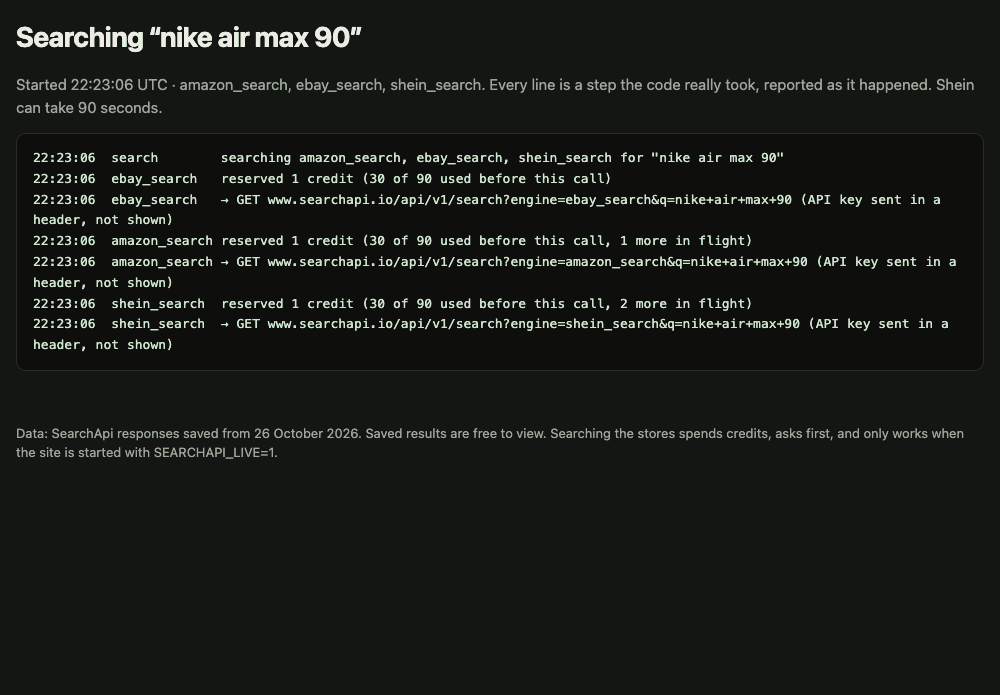
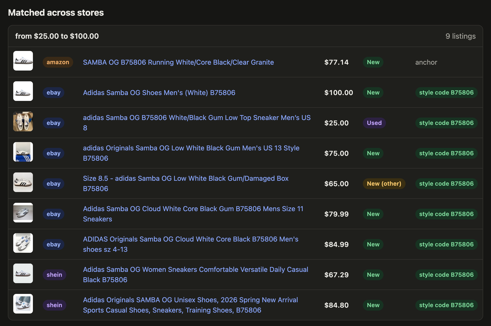
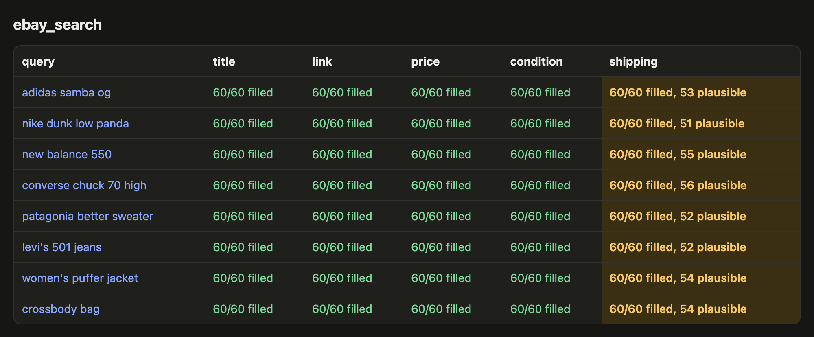

# cross-shop

[](https://github.com/bok1c4/cross-shop/actions/workflows/test.yml)

A small cross-store product search over Amazon and eBay through [SearchApi](https://www.searchapi.io), plus my own eBay parser to compare against theirs. Built on 26 October 2026 to understand SearchApi's e-commerce engines from both sides: as a customer, and as the engineer who keeps them working. It is the core of a product aggregator I once planned to build.

## Demo



A real search for "nike air max 90" (26 October 2026, 22:23 UTC), as the site's live console showed it. Every line is a step the code took, with SearchApi's own timings; the API key travels in a header and is never shown. Amazon answered in 3.3 s and eBay in 4.4 s; Shein got SearchApi's 503 after 90.9 s. The GIF is shortened: no frame stays on screen longer than 2 s, and the clock at the start of each line shows the real wait.



Nine listings for "adidas samba og" grouped by the style code B75806: an Amazon listing as the anchor, six from eBay, and two from Shein, read by cross-shop from the page SearchApi saved after answering "no results".



SearchApi's eBay `shipping` is filled on every listing, but on 53 of 480 it holds "Buy It Now", "or Best Offer" or a location instead. A fill-rate check would call it healthy.

The images come from the local site: `bin/screenshots` (stills, and the console recording) and `bin/frames-to-gif`.

## What it does

- **Fetches** 8 fashion queries from `amazon_search` and `ebay_search` through a cache-first client. A request is never paid for twice, nothing is sent without an explicit live flag, and calls stop at a credit cap. (Shein was tried 11 times over four hours: SearchApi answered "no results" twice, for pages that contained 20 products each, and failed with a 503 after about 90 s eight times, once reproduced with plain curl; once my client gave up first. Meanwhile status.searchapi.io, which has no per-engine status, said all systems were operational. The site reads the two pages SearchApi saved itself, so 40 Shein listings appear, marked as read by cross-shop.)
- **Normalises** every listing into one validated product record and **groups** the same product across stores: by manufacturer style code, or by brand, title words and price.
- **Parses eBay directly** and compares it with SearchApi's output, field by field.
- **Checks field health** (how often a field is filled, and how often its value is plausible), **simulates eBay layout changes**, and lets an agent (`claude -p`) repair the parser, with the tests as the judge.
- **Shows it all** in a small Sinatra site: search, how it works, field health, findings. Saved searches are free to open. A new search runs across the stores you tick, in parallel, and is saved; searching a saved term asks before running again and keeps the old results as history. A live console streams every real step of a search, including SearchApi's own timings and messages. Autocomplete comes from saved and past searches, so typing never spends a credit. Spending is guarded by a CSRF-protected POST, a confirmation, a redirect afterwards, and a credit cap that parallel requests cannot overshoot.

## Three things I learned

1. **A filled field is not a healthy field.** SearchApi's eBay `shipping` is filled on every listing, but on 53 of 480 (11%) it holds "Buy It Now", "or Best Offer" or "Located in United States". eBay's markup explains the likely cause: rows have no meaningful class names, and auction cards have extra rows, so reading by position shifts by one. My parser recognises rows by what they say; on the same query its shipping values were all plausible (49/49, against 88% for SearchApi). A fill-rate monitor would call SearchApi's field healthy; a plausibility check flags all 8 queries.
2. **An agent repairs mechanical breakage fast; review still matters.** I simulated four eBay layout changes (renamed rows, title, cards, a "US $" price prefix). Detection named the broken field each time. `claude -p`, allowed to edit only the parser and judged by the tests plus a held-out page, fixed all four on the first attempt: 44–101 s, 1–7 lines, about $1 each by the CLI's estimate. Reviewing the passing fixes still found a currency risk the tests could not see (the price fix strips any code before "$", so "AU $" would read as USD), comments stating invented history, and a "linter is clean" claim the agent could not check. Agents take the breadth; the judgement stays human.
3. **Cross-store matching without GTINs is mostly a variant problem.** None of the three search APIs returns a GTIN. Style codes appear in 26% of eBay titles but only 5% of Amazon's, and Amazon titles often name no colorway, because they are parent listings covering many colours and sizes. 45% of eBay listings for these queries are used. Match precision: *pending hand labels of the 39 grouped pairs.*
Also measured: the network layer gives a client away more reliably than the page does. Chrome's JA3 hash changed on every connection while its JA4 stayed fixed; Ruby and curl look nothing like a browser at the TLS and HTTP/2 level; default headless Chrome failed only 3 of 31 checks on bot.sannysoft.com, mostly because of its User-Agent. And eBay answered my third page request, 15 s after the second, from a fresh automated Chrome, with a 403.

## One surprise

eBay hides "Sponsored" from text scrapers. The label is an SVG image whose text uses Cyrillic look-alike letters and an invisible Unicode character, wired up through `aria-labelledby` references. In the raw HTML every one of the 62 cards carries it, so sponsored status cannot be read from the server's HTML alone. That is consistent with SearchApi returning no `is_sponsored` for eBay.

## Questions for SearchApi

1. **Should a parser miss be billed?** Measured with your Account API: failed searches are not billed, but both Shein "no results" answers were, although the pages you fetched contained the products. And do you track health per engine? Shein failed for me 9 times in 11 (eight of them your 503, each after 90.4–90.9 s, one reproduced with plain curl) while the status page, which shows the API as a whole, was green. (A side note for Ruby customers: `Net::HTTP` silently resends a GET once after a read timeout, measured as 2 requests for 1 call.)
2. **How do you catch output that is wrong but looks valid?** eBay's shipping field is filled but sometimes holds "Buy It Now". And for Shein, both "no results" answers I got came from pages that contained the products: the HTML you saved (`html_url`) has 20 listings in its embedded product JSON for each: 19 Adidas Sambas for "adidas samba og", and 20 Nike Air Force 1 / Air Jordan 1 for "nike air 1". Do you compare "no results" against the fetched page, or run plausibility checks beside fill rates, with baselines per query?
3. **How do your customers match products across stores without GTINs?** Is there demand for variant-level data, or for a product-detail call that returns GTIN or MPN?

## How it was built

- Ruby 3.4, Sinatra, Nokogiri, Ferrum; Minitest and standardrb. The library code was written test-first, with one exception (the fingerprint sanitizer, checked afterwards by planting bugs); the `bin/` scripts are thin and untested. Every bug or surprise is logged with its evidence in [LEARNINGS.md](LEARNINGS.md).
- Guardrails are structural: the API key cannot be a request parameter or end up in a saved file; every text input is read as UTF-8 explicitly (I hit the locale trap three times); saved fingerprints have IP addresses removed; the site escapes all scraped text and binds to 127.0.0.1.
- The saved store pages in this repo are trimmed to what the parsers read (`bin/trim-fixtures`): eBay's listing cards with the "Sponsored" labels they point to, and Shein's product list. Seller names, scripts, tracking data and the IP address in Shein's page config are left out of every commit, and a test fails if one comes back. The parsers give identical output on the trimmed and the original pages, also under all five simulated layout changes.
- Agent fix loop: each scenario runs in its own git worktree without the API key. The agent may edit only the parser and run only its tests, and the harness (not the agent) is the judge. Getting it to run took two fixes of its own (bugs 17 and 19 in LEARNINGS.md), including one where my harness had counted an expired login as three failed attempts.

## Limits

One day, one machine, one network (Belgrade). SearchApi returned no Shein data; the only Shein listings are the 40 read by cross-shop from two pages SearchApi saved. The eBay pages were fetched from Serbia and SearchApi's with US delivery, so shipping is not comparable between them, and only 20 and 27 of 60 listings overlapped. The eBay pages were fetched despite robots.txt, as a deliberate one-off: two pages, 15 s apart, stopped at the first 403. Health thresholds are judgement from one day of data.

## Run it

```bash
bundle install
bin/web                      # the site, on http://127.0.0.1:4567 (saved data only; free)
SEARCHAPI_LIVE=1 bin/web     # the same, with live search enabled (spends credits, asks first)
bundle exec rake             # tests and lint
bin/field-health             # field health of every saved response
bin/compare-ebay             # our parser against SearchApi
```
