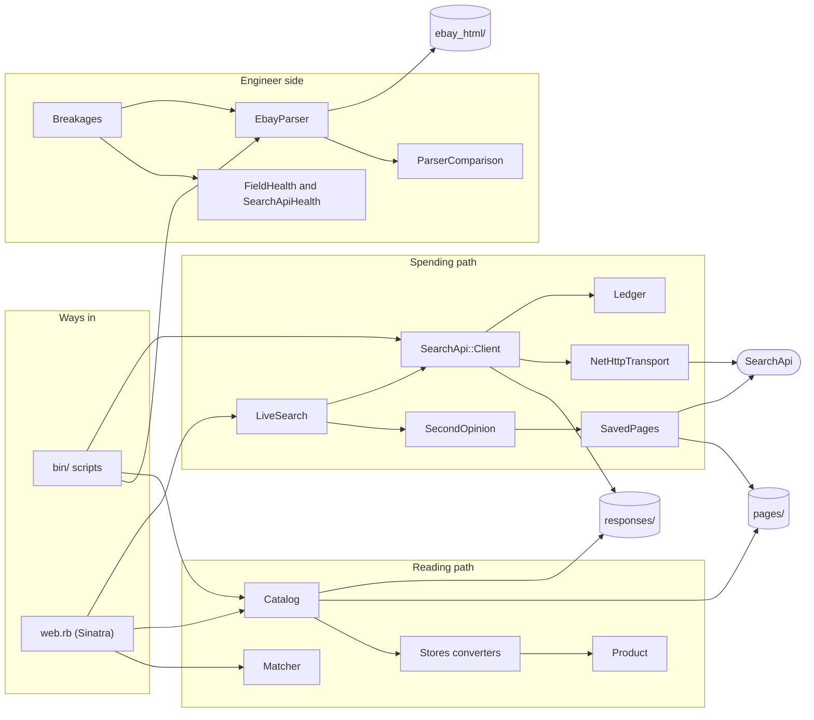
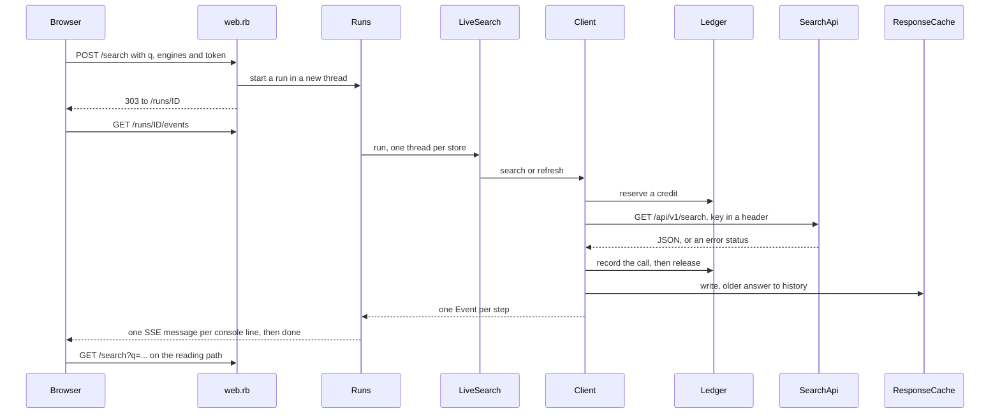

# Architecture

A guide to reading the code of cross-shop: what each part does, how a search moves through it, what lands on disk, and why it is built the way it is. Read it next to the code; every section names the files it describes.

What the project found is in the [README](../README.md); every bug and surprise, with its evidence, is in [LEARNINGS.md](../LEARNINGS.md) (referred to below as "bug N"); the Shein evidence is in [shein.md](shein.md).

## Contents

1. [What it is](#1-what-it-is)
2. [Rules the code enforces](#2-rules-the-code-enforces)
3. [Repository map](#3-repository-map)
4. [How to read the code](#4-how-to-read-the-code)
5. [Components](#5-components)
6. [Modules in depth](#6-modules-in-depth)
7. [Flows, end to end](#7-flows-end-to-end)
8. [Files on disk](#8-files-on-disk)
9. [Errors](#9-errors)
10. [Concurrency](#10-concurrency)
11. [Security and privacy](#11-security-and-privacy)
12. [Tests and tooling](#12-tests-and-tooling)
13. [Configuration](#13-configuration)
14. [Extending it](#14-extending-it)
15. [Known limits](#15-known-limits)
16. [Glossary](#16-glossary)

## 1. What it is

A small Ruby library, `lib/cross_shop/`, with two ways in: command-line scripts in `bin/` and a Sinatra site (`lib/cross_shop/web.rb`). There is no database. Everything is read from and written to files in `config/`, `fixtures/` and `data/`, most of them committed, so the tests and the site run offline.

It has two halves:

- **Customer side.** Search Amazon, eBay and Shein through SearchApi, turn every listing into one validated record, and group listings of the same product across stores.
- **Engineer side.** Parse eBay's own search pages and compare the result with SearchApi's, field by field; check the health of each field; simulate eBay layout changes and let an agent repair the parser, with tests as the judge; record how different HTTP clients look to a server.

It is a one-machine experiment, not a service: one process, files instead of a database, runs kept in memory.

## 2. Rules the code enforces

These run through the whole codebase. Most of them exist because something went wrong once; the bug numbers say what.

1. **Spending is explicit and capped.** A SearchApi call costs a credit. The client reads the cache first, sends nothing unless live mode is on (`SEARCHAPI_LIVE=1`), stops at 90 recorded calls, and never retries (bug 1). Each of these is a raised error, not a rule to remember.
2. **Two separate paths: spending and reading.** Only `SearchApi::Client` (and `SavedPages#fetch`) can send a request. `Catalog`, which every page of the site and most scripts use, only reads files, so it cannot spend anything.
3. **One record shape, validated when it is built.** Every listing becomes a `Product`. A listing that fails validation becomes a `Reject` with its reason; nothing is dropped silently.
4. **Everything speaks SearchApi's shape.** Our own parsers (`EbayParser`, `SheinPage`) output SearchApi's field names, so the same converters, health rules and comparison work on both.
5. **Missing is not "no results".** An engine without data is reported with its reason ("not cached", "SearchApi: Shein didn't return any results."), never shown as an empty store (bugs 11 and 18).
6. **Dependencies are passed in.** The transport, cache, ledger, observer and even `sleep` are constructor arguments, so tests replace them and never touch the network.
7. **Text is UTF-8 at every edge.** Files, command-line arguments and CSVs are read as UTF-8 explicitly; without it Ruby follows the locale and breaks under `LANG=C` (bugs 2 and 10).
8. **Secrets and other people's data stay out.** The API key travels only in a header, only to SearchApi, and is never written to disk. Saved pages are trimmed to what the parsers read before they are committed (bug 26).
9. **The console shows only what happened.** Every line on the site's live console comes from an event emitted by the code that did the step.

## 3. Repository map

```
lib/cross_shop/
  search_api.rb              wiring: data folder, credit cap, client from environment
  search_api/
    client.rb                cache-first client; the only way to spend a credit
    ledger.rb                every live call, one JSON line each; the credit counter
    response_cache.rb        one file per distinct request; re-runs kept as history
    net_http_transport.rb    the real HTTP (Net::HTTP, no retries, 120 s)
    response.rb              Response(status, body): what any transport returns
    saved_pages.rb           the store page SearchApi saved (html_url)
    batch_fetch.rb           fetch every missing query × engine, a few per run
  product.rb                 the one listing record, validated
  brands.rb                  the known brands, as patterns
  stores.rb                  engine name => converter, engine name => page parser
  stores/base.rb             shared converter helpers: convert_each, brand, currency
  stores/amazon.rb           SearchApi Amazon results => Products
  stores/ebay.rb             SearchApi eBay results => Products
  stores/shein.rb            SearchApi Shein results => Products
  query_set.rb               config/queries.yml
  catalog.rb                 one query's Products, read from disk only
  matcher.rb                 which listings are the same product
  match_labels.rb            the hand-labelled sample and its precision
  shein_page.rb              products read from a saved Shein page
  second_opinion.rb          reads the saved page when SearchApi says "no results"
  ebay_parser.rb             our own eBay search-page parser
  parser_comparison.rb       our parser against SearchApi, field by field
  field_health.rb            fill rate and plausibility checks
  searchapi_health.rb        the concrete rules per engine
  breakages.rb               simulated eBay layout changes, detection by baseline
  fingerprint.rb             TLS/HTTP fingerprints without IP addresses
  trim_page.rb               cuts saved pages down to what the parsers read
  event.rb                   Event(at, engine, kind, data): one real step
  live_search.rb             one query, several stores, one thread each
  runs.rb                    live searches running in the background
  console.rb                 one console line per Event
  web.rb                     the Sinatra site
  web/views/*.erb            one template per page, plus layout.erb
  web/public/style.css       the site's styles
bin/                         command-line scripts (section 6.14)
config/queries.yml           the engines and the 8 starter queries
config.ru                    Rack entry point for the site
fixtures/                    saved responses, pages, ledger, fingerprints (section 8)
data/                        match labels, agent fix log and diffs
docs/                        README images, shein.md, this file
test/                        mirrors lib/ (section 12)
```

## 4. How to read the code

A reading order that builds up from the data to the site:

1. [product.rb](../lib/cross_shop/product.rb): the record everything else produces.
2. [stores/base.rb](../lib/cross_shop/stores/base.rb), then [stores/ebay.rb](../lib/cross_shop/stores/ebay.rb): how one response becomes Products and Rejects.
3. [catalog.rb](../lib/cross_shop/catalog.rb): one query across all stores, from disk.
4. [matcher.rb](../lib/cross_shop/matcher.rb): grouping.
5. [search_api/client.rb](../lib/cross_shop/search_api/client.rb), with [ledger.rb](../lib/cross_shop/search_api/ledger.rb), [response_cache.rb](../lib/cross_shop/search_api/response_cache.rb) and [net_http_transport.rb](../lib/cross_shop/search_api/net_http_transport.rb): the spending path.
6. [live_search.rb](../lib/cross_shop/live_search.rb), [runs.rb](../lib/cross_shop/runs.rb), [console.rb](../lib/cross_shop/console.rb), then [web.rb](../lib/cross_shop/web.rb): the site.
7. [ebay_parser.rb](../lib/cross_shop/ebay_parser.rb), [field_health.rb](../lib/cross_shop/field_health.rb), [breakages.rb](../lib/cross_shop/breakages.rb), then [bin/agent-fix](../bin/agent-fix): the engineer side.

Most files open with a comment saying what they are for; read that first. The matching test file (`test/cross_shop/<name>_test.rb`) shows the behaviour with real examples.

### Ruby idioms used here

For readers coming from Python, Go or JavaScript:

| Ruby | What it does | Closest equivalent |
|---|---|---|
| `Product = Data.define(:a, :b)` | Immutable value object with a keyword constructor and `==` by value | Python `@dataclass(frozen=True)`, a Go struct passed by value |
| `module Matcher` with `def self.match` | A namespace of functions, no instances | A Python module of functions, a Go package |
| `Product.new(store:, title:)` | Keyword shorthand: `store:` means `store: store` | JS `{store, title}` |
| `items.each do \|item\| ... end`, `yield` | A block: a callback passed to a method | A lambda or callback argument |
| `->(html) { ... }` | A lambda stored in a variable or constant | Python `lambda`, a JS arrow function |
| `value&.size` | Call only if not nil | JS `?.` |
| `filter_map { ... }` | Map, then drop nils and falses | `[f(x) for x in xs if f(x)]` |
| `rescue *FAILURES => error` | Rescue any exception class in the list | Python `except (A, B) as error` |
| `Thread.new { ... }.value` | Run in a thread, then wait for its return value | A future or promise |
| `Mutex#synchronize`, `ConditionVariable` | Lock; wait until signalled | Go `sync.Mutex`, `sync.Cond` |
| `Hash.new(0)` | A hash whose missing keys read as 0 | Python `defaultdict(int)` |
| `**params` | Collect or pass keyword arguments | Python `**kwargs` |
| `run.method(:add)` | A method as a callable object | A Python bound method, `run.add` |
| `/\A...\z/` | Start and end of the whole string; `^` and `$` match at every line break in Ruby | Python `\A`, `\Z` |
| `.freeze` | Stops changes to the object, not reassignment (bug 5) | `Object.freeze` in JS |
| `%w[a b c]` | An array of words | `["a", "b", "c"]` |

## 5. Components



## 6. Modules in depth

### 6.1 The SearchApi layer: `lib/cross_shop/search_api/`

**[client.rb](../lib/cross_shop/search_api/client.rb): `SearchApi::Client`.** The only object that spends credits.

- `search(engine, **params)` returns the cached response if there is one (no credit), raises `CacheMiss` if live mode is off, and otherwise fetches and stores.
- `refresh(engine, **params)` always fetches (the site's "run again"); the previous answer is kept as history.
- `fetch_and_store` reserves a credit in the ledger, fetches, releases the reservation, refuses to cache a body containing the key (`SecretInResponse`), then writes the cache.
- `fetch` sends the request with the key in the `Authorization` header and writes a ledger line whatever happens: success, non-200, or a network error (which is then re-raised).
- `metadata` reads what SearchApi says about its own work from `search_metadata`: search id, the URL it fetched, `request_time_taken`, `parsing_time_taken`, and the top-level `error` field, which SearchApi also sends with HTTP 200 (for example "Shein didn't return any results.").
- Constructor arguments: `cache`, `ledger`, `transport`, `live`, `api_key`, `credit_limit`, and an optional `observer` that receives an `Event` for every step.
- `ENDPOINT` is frozen, because a frozen constant can still be changed in place otherwise (bug 5). Passing `api_key` as a search param raises `ArgumentError`: the key belongs to the client, not to a request.

Events emitted: `cache_hit`, `credit_reserved`, `request_sent`, `response_received`, `request_failed`, `saved`.

**[ledger.rb](../lib/cross_shop/search_api/ledger.rb): `SearchApi::Ledger`.** `fixtures/searchapi/ledger.jsonl`, one JSON line per live call. Its line count is the credit counter.

- `reserve(limit)`: in one locked step, reads the recorded count and the calls in flight, refuses if together they reach the limit, otherwise counts one more call in flight and returns `Reservation(recorded:, in_flight:)`. Checking first and calling afterwards let three parallel calls through on two credits in a test; doing both under one lock fixes that. The snapshot is what the console prints (bug 25).
- `release`: one call fewer in flight, after it has been recorded.
- `RESERVATIONS` and `LOCK` are class-level, keyed by the file's absolute path, because the site builds a new client and ledger per request: a lock inside one object would not cover two requests.
- `queries`: every query ever sent, newest first, which is the free source of the site's autocomplete.
- The cap counts every line, failed calls included, so it is stricter than SearchApi's billing (failed calls were not billed, measured with the Account API).

**[response_cache.rb](../lib/cross_shop/search_api/response_cache.rb): `SearchApi::ResponseCache`.** One file per distinct request.

- Path: `<root>/<engine>/<slug>-<digest>.json`, for example `responses/ebay_search/adidas-samba-og-d7e25acfc5bc7408.json`. The slug (from `q`) is for people; the digest (first 16 hex characters of a SHA-256 of the engine and every param, keys and values as strings, sorted) makes it unique. Adding any param is a different request and a different file.
- `write` moves an existing file to `<engine>/history/<file name without .json>/<timestamp>.json` before writing, because a response on disk was paid for. `history` lists them newest first.
- The engine name becomes a directory name and can come from the command line, so it must match `/\A[a-z0-9_]+\z/` (bug 4).
- `read` passes `encoding: UTF_8` (bug 2).

**[net_http_transport.rb](../lib/cross_shop/search_api/net_http_transport.rb): `SearchApi::NetHttpTransport`.** One GET per call over the standard library's `Net::HTTP`. `max_retries: 0`, because `Net::HTTP` otherwise resends a GET once after a read timeout, and each request may be billed (bug 1). Open timeout 10 s; read timeout `READ_TIMEOUT = 120`, longer than SearchApi's own 90 s deadline on Shein (bug 27). Returns a `Response`.

**[response.rb](../lib/cross_shop/search_api/response.rb).** `Response = Data.define(:status, :body)`. The client depends only on this shape, so any object with `get(uri, query:, headers:)` returning it can be the transport: the tests' `FakeTransport`, or a per-engine fake in the site tests.

**[saved_pages.rb](../lib/cross_shop/search_api/saved_pages.rb): `SearchApi::SavedPages`.** The store page SearchApi fetched for a search, from `search_metadata.html_url`, stored as `pages/<engine>/<search_id>.html` and never downloaded twice. `fetch` sends the key only if the URL is `https` on `www.searchapi.io`, because the URL comes from a response. Both parts of the file path (engine, search id) are checked against patterns. Downloading is free (measured). Pages are stored as received; trimming is a separate step (section 6.13).

**[batch_fetch.rb](../lib/cross_shop/search_api/batch_fetch.rb): `SearchApi::BatchFetch`.** Used by `bin/fetch-queries`. `missing` lists the query × engine pairs not cached yet, query by query, so a partial run leaves whole queries done. `run` fetches at most `max_live_calls` of them with a pause in between (SearchApi allows at most 20% of a plan's credits per hour), and the first error stops the run.

**[search_api.rb](../lib/cross_shop/search_api.rb).** The wiring: `DATA_DIR` (`fixtures/searchapi`), `CREDIT_LIMIT = 90` (100 trial credits, 10 in reserve), and factories for the cache, ledger, saved pages, transport and client. `client_from_env` turns live mode on only when `SEARCHAPI_LIVE` is exactly `"1"`, and reads the key only then, with `ENV.fetch`, so a missing key fails loudly while cached runs need none.

### 6.2 The record: `Product`

[product.rb](../lib/cross_shop/product.rb). `Product` is a `Data` subclass whose constructor checks every field and raises `Product::Invalid` with the reason. `Invalid` subclasses `ArgumentError`, so converters can rescue bad data without also swallowing programming errors such as a misspelled keyword.

| Field | Rule |
|---|---|
| `store` | `"amazon"`, `"ebay"` or `"shein"` |
| `store_id` | non-blank: ASIN, eBay item ID, Shein goods ID |
| `title` | non-blank |
| `link` | starts with `https://` |
| `price_min`, `price_max` | positive numbers, min ≤ max (eBay listings can be a price range); stored as floats |
| `currency` | `"USD"` only |
| `condition` | `"new"`, `"new_other"` or `"used"` |
| `brand`, `brand_source` | both nil or both set; source is `field`, `title` or `subtitle` |
| `image` | any, optional |
| `rating` | nil or 0–5 |
| `reviews_count` | nil or an integer ≥ 0 |
| `sponsored` | `true`, `false` or `nil` (unknown) |

### 6.3 Converters: `lib/cross_shop/stores/`

[stores/base.rb](../lib/cross_shop/stores/base.rb) holds what all converters share:

- `Stores.convert_each(store, items, id_field) { |item| Product.new(...) }` returns `Conversion(products:, rejects:)`. Each `Product::Invalid` becomes `Reject(store:, store_id:, reason:)`.
- `Stores.brand(field:, title:, subtitle:)` returns `[brand, source]`: the store's brand field first (normalised through `Brands` when it is a known brand), then a known brand in the title, then in the subtitle.
- `Stores.currency(price_text)` maps a leading `$` to `"USD"`, because every query uses US domains. Anything else gives nil, and the listing becomes a reject.

One converter per store, each a module with `convert(response)`:

| | [Amazon](../lib/cross_shop/stores/amazon.rb) | [eBay](../lib/cross_shop/stores/ebay.rb) | [Shein](../lib/cross_shop/stores/shein.rb) |
|---|---|---|---|
| `store_id` | `asin` | `item_id` | `product_id` |
| Price | `extracted_price` | `extracted_price_range` (`from`, `to`), else `extracted_price` | `extracted_price_usd`, else `extracted_price` |
| Condition | always `new` (no field; a search shows the main offer) | `Brand New`, `New (Other)`, `Pre-Owned` mapped; anything else is a reject | always `new` |
| Brand | `brand` field, else title | title, else subtitle (no brand field) | `brand` field, else title |
| Sponsored | `is_sponsored == true` | `nil`: SearchApi never sends it for eBay | `nil` |

[stores.rb](../lib/cross_shop/stores.rb) holds two registries: `BY_ENGINE` (engine name → converter) and `PAGE_PARSERS` (engine name → a lambda that reads listings from a saved page; only Shein has one). [brands.rb](../lib/cross_shop/brands.rb) knows the six brands of the query set, as word-boundary patterns; a real aggregator would need a large dictionary.

### 6.4 `Catalog`: one query, from disk

[catalog.rb](../lib/cross_shop/catalog.rb). `search(query)` goes through the configured engines and, for each:

1. Nothing cached → `missing_engines[engine] = "not cached"`.
2. SearchApi answered with an `error` (such as "no results") → `recover` reads the saved page with the engine's page parser, if both exist. Listings found → converted, plus a `notes[engine]` line saying where they came from. None → `missing_engines[engine] = "SearchApi: <message>"`.
3. No converter → `missing_engines[engine] = "no converter yet"`.
4. Otherwise → converted.

It returns `Result(query:, products:, rejects:, missing_engines:, notes:)`. `coverage(queries)` counts cached responses per engine for the home page. `Catalog` only reads files.

### 6.5 `Matcher`: the same product in different stores

[matcher.rb](../lib/cross_shop/matcher.rb). None of the three search APIs returns a GTIN, so matching uses what titles contain.

**Two tiers, tried in order for each pair of listings from different stores:**

- **`style_code`** (score 1.0): both titles contain the same manufacturer style code. `style_codes` upper-cases the title, takes tokens of letters and digits with at most one hyphen, and keeps those of six or more characters whose part before the hyphen mixes letters and digits: `JH5633`, `DD1391-100`, `BB550WT1` qualify; `4XL` and `BB550` are too short; `2-PIECE` has no mixed head (bug 24). A shared code is a match whatever the prices.
- **`title`** (score = similarity): the same known brand, prices within a factor of `MAX_PRICE_RATIO = 1.5`, and title similarity of at least `MIN_TITLE_SIMILARITY = 0.5`. Similarity is Jaccard over title words: lower-cased, apostrophes removed, one-letter words and `STOPWORDS` ("men", "shoes", "size" and so on) dropped; shared words divided by all words.

**From pairs to groups:**

- `candidates(products)`: every cross-store pair that matches (all pairs, so it grows with the square of the listing count; fine for a few hundred).
- `best_matches(candidates)`: for each non-Amazon listing, its single best Amazon candidate. A style-code match always beats a title match (`TIER_WEIGHT`), and within a tier the score decides. Pairs without exactly one Amazon listing (eBay with Shein) are ignored.
- `groups(products)`: each Amazon listing anchors a group of the listings attached to it; every other listing is a group of one. Amazon anchors because its titles are the cleanest. Following every chain instead (A~B and B~C puts A with C) merged 33 adidas listings into one group (bug 8).

The site shows groups with more than one store as "Matched across stores".

[match_labels.rb](../lib/cross_shop/match_labels.rb) writes `data/match_labels.csv`, one row per pair the grouping uses, and keeps the `label` (y/n) and `note` already filled in when it is regenerated (rows are keyed by Amazon ID, other store and other ID). `precision(rows)` counts correct pairs per tier, over labelled rows only.

### 6.6 Shein: reading the saved page

SearchApi answered twice with "Shein didn't return any results." for pages that contained 20 products ([shein.md](shein.md)). Two parts read them:

**[shein_page.rb](../lib/cross_shop/shein_page.rb): `SheinPage.organic_results(html, domain:)`.** Finds the embedded `"products":[` JSON in the page and cuts out the whole array by counting brackets outside strings. It works on bytes: indexing a UTF-8 string by character makes Ruby scan from the start every time, and the first version took minutes on a 1.9 MB page. Each product is mapped to SearchApi's `organic_results` shape, so `Stores::Shein` converts it:

| Shein page | Output key |
|---|---|
| `goods_id` | `product_id` |
| `goods_sn` | `sku` |
| `goods_name` | `title` |
| `goods_url_name` + `goods_id` | `link` (`https://<domain>/<name>-p-<id>.html`) |
| `premiumFlagNew.brand_badge_name` | `brand` |
| `salePrice.usdAmount` | `extracted_price`, `extracted_price_usd` |
| `retailPrice.usdAmount` | `extracted_original_price`, only when higher than the sale price |
| `comment_rank_average` | `rating`, only when there are reviews (Shein shows "0" for unrated) |
| `comment_num` | `reviews` |
| `goods_img` | `thumbnail` (`//` becomes `https://`) |

**[second_opinion.rb](../lib/cross_shop/second_opinion.rb): `SecondOpinion#call(engine, response)`.** During a live search, when SearchApi answers with an `error` and the engine has a page parser, it downloads the saved page (free) and counts the listings on it, so the console shows both answers. Any failure is reported as an event, never raised: the check must not break the search. Events: `second_opinion_started`, `second_opinion`, `second_opinion_failed`.

### 6.7 Our eBay parser

**[ebay_parser.rb](../lib/cross_shop/ebay_parser.rb): `EbayParser.parse(html)`.** Reads eBay's search page (the `s-card` layout of October 2026) into listings with SearchApi's eBay field names.

- Cards: `li.s-card`. A card is a listing only if it links to `/itm/` followed by a 12-digit ID; others ("Shop on eBay") are skipped. Duplicates by item ID are dropped and positions renumbered.
- The link is rebuilt as `https://www.ebay.com/itm/<id>`, without tracking parameters.
- Title: `.s-card__title .su-styled-text.primary`. Subtitles: the first one that names a condition becomes `condition`; the rest are joined into `subtitle`.
- Rows (`.s-card__attribute-row`) have no meaningful class names, and auction cards have extra rows, so reading by position shifts by one. Each row is recognised by what it says: the first starting with `$` is the price (a range when it contains " to "); a bid count or "Buy It Now"/"or Best Offer" is `buying_format`; text with delivery, shipping or postage is `shipping` (with `extracted_shipping`, 0.0 for "Free"); "N sold" is `items_sold`; anything else goes to `extensions`.
- Rating and review count come from the card's text ("4.5 out of 5 stars", "120 product ratings").
- `words(node)` joins text nodes with spaces; `node.text` would glue "Time left" and "1d 4h" together.
- No `is_sponsored`: eBay draws "Sponsored" as an SVG with look-alike letters, and every card carries it in the raw HTML, so it cannot be read from the server's page (the README's "one surprise").

**[parser_comparison.rb](../lib/cross_shop/parser_comparison.rb): `ParserComparison.compare(ours:, theirs:)`.** Pairs listings by item ID. Only listings present in both are compared, because the two sides were fetched at different times from different places; the rest are listed as `only_ours` and `only_theirs`. For each field in `FIELDS` it counts `agree`, `differ`, `only_ours` and `only_theirs`, with up to five examples of differences. Numbers agree within half a cent; strings agree ignoring whitespace.

### 6.8 Field health

**[field_health.rb](../lib/cross_shop/field_health.rb).** A `Rule` has a `field`, `min_filled` (share of listings that must have it), an optional `read` lambda (default `item[field]`), an optional `valid` lambda for plausibility, and `min_valid` (default 1.0). `check(items, rules)` returns one `Report(field, total, filled, valid, passed, problem)` per rule. Blank means nil, empty, or whitespace. An empty batch always fails with "no listings": zero listings is a signal of its own.

**[searchapi_health.rb](../lib/cross_shop/searchapi_health.rb).** The rules a customer could run on every response, from one day of data:

| Engine | Field | Filled at least | Plausible |
|---|---|---|---|
| `ebay_search` | `title` | 100% | |
| | `link` | 100% | starts with `https://www.ebay.com/itm/` |
| | `price` (`extracted_price` or `extracted_price_range`) | 95% | |
| | `condition` | 95% | one of the mapped conditions, 95% |
| | `shipping` | 90% | mentions delivery, shipping or postage, 95% |
| `amazon_search` | `asin` | 100% | ten letters or digits |
| | `title` | 100% | |
| | `extracted_price` | 90% | |
| | `brand` | 70% | |
| | `rating` | 70% | between 0 and 5 |

The eBay `shipping` rule is the one that catches "Buy It Now" in the shipping field: filled on every listing, not always plausible.

### 6.9 Breakages and the agent fix loop

**[breakages.rb](../lib/cross_shop/breakages.rb).** Five simulated eBay layout changes, each a string rewrite of a saved page (`Scenario(description:, apply:)` in `ALL`):

| Scenario | Change |
|---|---|
| `row_class_renamed` | `s-card__attribute-row` → `s-card__detail-row` |
| `title_class_renamed` | `s-card__title` → `s-card__headline` |
| `price_prefix_added` | "$99.99" → "US $99.99" |
| `card_class_renamed` | `li.s-card` → `li.s-tile` |
| `price_class_renamed` | `s-card__price` → `s-card__amount`; a control: the parser does not use that class |

`health(html)` parses a page and checks it with the eBay rules. `regressions(baseline, current)` compares a page with its own baseline instead of fixed thresholds, because one bar did not fit every query: the listing count falling by more than `TOLERANCE` (10%) is reported alone; otherwise each field whose filled or plausible share fell by more than 0.1 is reported.

**[bin/agent-fix](../bin/agent-fix).** For each breaking scenario (all but the control):

1. Creates a git worktree of `HEAD` in a temporary folder (no `.env` inside) and applies the breakage to both saved eBay pages.
2. Runs the judge once: if the parser already copes, there is nothing to fix.
3. Asks `claude -p` to fix the parser, with tools limited to reading, editing `lib/cross_shop/ebay_parser.rb` only, and running the parser test command only. The environment has no `SEARCHAPI_API_KEY` and none of the surrounding app's `CLAUDE*`/`ANTHROPIC*` variables (bug 19).
4. Judges: only the parser changed, the pages are byte-identical to the broken versions, the parser tests pass, and the held-out page (`nike-dunk-low-panda.html`, which the parser tests do not read) shows no regression against its baseline from the unbroken original.
5. On failure, sends the judge's findings back in the same agent session, up to 3 attempts of at most 15 minutes each.
6. Appends every attempt to `data/agent_fix_log.jsonl`, writes the passing diff to `data/agent_fixes/<scenario>.diff`, and removes the worktree.

An agent that never ran (an expired login) is recorded as an error and stops the script, instead of counting as failed attempts (bug 17).

### 6.10 Fingerprints

**[fingerprint.rb](../lib/cross_shop/fingerprint.rb).** For responses from tls.peet.ws. `sanitize` deep-copies a response without addresses and per-connection randomness (`ip`, `src_ip`, `dst_ip`, `client_random`, `session_id`, `donate`) and replaces any IPv4 address left in a string. The pattern ignores dotted numbers right after "/", so `Chrome/143.0.0.0` stays a version (bug 14). `summary` picks JA3, JA4, the HTTP/2 fingerprint hash, cipher and extension counts, TTL and the TCP signature. The scripts are `bin/fingerprints` (Ruby, curl and headless Chrome against tls.peet.ws) and `bin/headless-signals` (bot.sannysoft.com); no store is contacted.

### 6.11 Live search, runs and the console

**[event.rb](../lib/cross_shop/event.rb).** `Event = Data.define(:at, :engine, :kind, :data)`; `engine` is nil for events about the whole run.

**[live_search.rb](../lib/cross_shop/live_search.rb): `LiveSearch#run(query, engines, refresh:)`.** One thread per store, then waits for all of them. The waiting is network I/O, which Ruby threads overlap despite the global VM lock (like Python's GIL), so the slowest store sets the time, not the sum. Each store gives an `Outcome(engine:, status:, message:)`: `saved` (already on disk and not a re-run: nothing spent), `fetched`, or `failed`. Expected failures (`FAILURES`: SearchApi errors and network errors) become a `failed` outcome, so one store failing never fails the others; anything else is a bug and propagates. When SearchApi's answer has an `error`, it calls the second opinion. Emits `engine_finished`.

**[runs.rb](../lib/cross_shop/runs.rb).** `Run` holds one live search's events behind a `Mutex`. `events_after(index, timeout:)` returns the events after `index`, waiting on a `ConditionVariable` up to `timeout` seconds if there are none yet, so the event stream waits without polling. `Runs#start(query:, engines:) { |run| ... }` runs the block in a new thread and keeps the last 20 runs in memory; a crash becomes a `run_failed` event and is logged in full to standard error, so a waiting console never hangs.

**[console.rb](../lib/cross_shop/console.rb): `Console.line(event)`.** Time, source (engine or "search"), and a sentence per event kind:

| Kind | Emitted by | Console text (shortened) |
|---|---|---|
| `run_started` | web.rb | searching amazon_search, ebay_search for "…" |
| `cache_hit` | Client | already saved, no credit spent: fixtures/… |
| `credit_reserved` | Client | reserved 1 credit (27 of 90 used before this call, 2 more in flight) |
| `request_sent` | Client | → GET www.searchapi.io/api/v1/search?… (API key sent in a header, not shown) |
| `response_received` | Client | ← 200 in 4.4 s · SearchApi fetched … in … s, parsed in … s · 60 results · search_… |
| `request_failed` | Client | ✗ Net::ReadTimeout … after … s |
| `saved` | Client | saved fixtures/… (previous results kept as history) |
| `second_opinion_started`, `second_opinion`, `second_opinion_failed` | SecondOpinion | second opinion: … the page it fetched has 20 listings … |
| `engine_finished` | LiveSearch | done: fetched |
| `run_finished` | web.rb | finished in … s |
| `run_failed` | Runs | ✗ the search crashed: … |

### 6.12 The site

**[web.rb](../lib/cross_shop/web.rb): `CrossShop::Web < Sinatra::Base`.**

| Route | What it does | Spends credits |
|---|---|---|
| `GET /` | Search box with local autocomplete (configured queries plus every query in the ledger), chips for saved queries, credits used, coverage per engine | no |
| `GET /search?q=` | Saved results: `Catalog#search`, then `Matcher`; matched groups, unmatched listings by store, rejects, missing engines, notes; the "run again" form when live | no |
| `POST /search` | Starts a live run for the ticked stores, then redirects (303) to its console | yes, up to one per ticked store |
| `GET /runs/:id` | The console: the events so far, then a script that streams the rest | no |
| `GET /runs/:id/events` | Server-Sent Events: one message per console line, then `event: done` | no |
| `GET /how` | How it works | no |
| `GET /health` | Field health of every saved response, and the agent fix attempts | no |
| `GET /notes` | LEARNINGS.md rendered with kramdown | no |

Guards on the one route that spends:

- Live mode must be on (`SEARCHAPI_LIVE=1` at start), otherwise 403.
- The form carries a CSRF token (`Rack::Protection::AuthenticityToken`); the session secret is random per start unless `SESSION_SECRET` is set.
- The query must be 1–100 characters, and every ticked store must be an engine from `config/queries.yml`.
- The browser asks for confirmation with the number of credits (a convenience; the server-side guards above are what count).
- POST, then a 303 redirect: reloading the console page cannot spend again.
- The credit cap in the ledger, shared by parallel runs.

The event stream: the console page renders the events it already has, then opens an `EventSource` on `/runs/:id/events?from=<count>`. The server waits up to 15 s for new events, sends each as `id: <n>` plus `data: {"line": "…"}`, sends a `: still working` comment when there is nothing new (keeps the connection open), and ends with `event: done`. A reconnecting browser sends `Last-Event-ID`, so no line is sent twice.

Settings worth knowing:

- `set :erb, escape_html: true`: every `<%= %>` is escaped, because listing text comes from other people's websites; raw HTML needs `<%== %>` (bug 12).
- `set :reload_templates, false`: templates are read once at start, like the Ruby code, so a long-running server never pairs new views with old classes; a change to either needs a restart (bug 23).
- Templates run in the app's scope and cannot see `CrossShop` constants by short name, hence the `console_line` helper (bug 22).
- `bin/web` binds to 127.0.0.1, so the site is not reachable from the local network. Sinatra's host authorization rejects other host names (bug 13).

Views in `lib/cross_shop/web/views/`: `layout.erb` (header, navigation, footer), `home.erb`, `search.erb`, `run.erb`, `how.erb`, `health.erb`, `notes.erb`. Styles in `web/public/style.css`.

### 6.13 Publishing safely: `TrimPage`

**[trim_page.rb](../lib/cross_shop/trim_page.rb).** An allowlist: whatever a page adds next stays out by default.

- `TrimPage.ebay(html)` keeps the listing cards and the label elements their `aria-labelledby` points to (the "Sponsored" labels sit outside the cards), and removes `data-*` and `_sp` attributes and query strings from links. Seller names, which sit outside the cards, are gone.
- `TrimPage.shein(html)` keeps only the `"products":[…]` array. The page config around it holds the fetching client's IP address.

[bin/trim-fixtures](../bin/trim-fixtures) copies each original to `private/originals/` (git-ignored) the first time, then always trims from the original, so running it twice changes nothing. The parsers give the same output on trimmed and original pages. [public_fixtures_test.rb](../test/cross_shop/public_fixtures_test.rb) fails if an IPv4 address (outside harmless ranges) or a seller line appears anywhere in `fixtures/` or `data/`.

### 6.14 The scripts in `bin/`

Thin wrappers: the logic is in `lib/`. Each starts with a comment explaining its use.

| Script | What it does | Spends |
|---|---|---|
| [searchapi](../bin/searchapi) | One request: `bin/searchapi ENGINE key=value …`; prints the search id and the first results | only with `SEARCHAPI_LIVE=1` and not cached |
| [fetch-queries](../bin/fetch-queries) | Lists cached and missing query × engine pairs; with live mode, fetches up to `MAX_LIVE_CALLS` (≤ 15) of the missing ones, 3 s apart | as above |
| [web](../bin/web) | Starts the site with rackup on 127.0.0.1:4567 (or `$PORT`) | through the site only |
| [capture-ebay](../bin/capture-ebay) | The one-off eBay capture: a visible Chrome (Ferrum), the URLs SearchApi used, 15 s apart, stopping at the first abnormal answer; logs each request to `captures.jsonl` | no (contacts eBay) |
| [compare-ebay](../bin/compare-ebay) | Our parser against SearchApi for each saved eBay page | no |
| [field-health](../bin/field-health) | Every health rule over every saved response; exits 1 if any fails | no |
| [label-matches](../bin/label-matches) | Writes `data/match_labels.csv`, keeping labels already filled in | no |
| [precision](../bin/precision) | Precision from the labels, and the wrong matches | no |
| [agent-fix](../bin/agent-fix) | The fix loop (section 6.9) | no (runs `claude -p`) |
| [fingerprints](../bin/fingerprints), [headless-signals](../bin/headless-signals) | Phase 4 measurements against test sites | no |
| [trim-fixtures](../bin/trim-fixtures) | Trims saved pages (section 6.13) | no |
| [screenshots](../bin/screenshots), [frames-to-gif](../bin/frames-to-gif) | README images; `console QUERY --spend` records a real live search | only with `--spend` |

## 7. Flows, end to end

### 7.1 A live search from the site



1. The form in `search.erb` posts to `POST /search`, which checks live mode, the token, the query and the stores.
2. `settings.runs.start` starts a thread and the browser is sent to `/runs/:id` at once.
3. In the thread, a `Client` is built with `observer: run.method(:add)`, so every step lands in the run as an `Event`. `LiveSearch#run` starts one thread per store.
4. Per store: `Client#search` (or `#refresh` for a re-run) → `Ledger#reserve` → `fetch` sends the GET and records a ledger line → `release` → the key check → `ResponseCache#write`.
5. If SearchApi answered with an `error`, `SecondOpinion` downloads the saved page and counts its listings.
6. `GET /runs/:id/events` streams each event as a console line. When the run ends, the page shows a link to the results.
7. `GET /search?q=…` reads what was saved (7.2).

### 7.2 Opening a saved search

1. `GET /search?q=…` calls `Catalog#search`: for each engine it reads the cached response (or recovers listings from the saved page), and the store's converter builds Products and Rejects.
2. `Matcher.candidates` finds matching pairs; `Matcher.groups` builds Amazon-anchored groups; groups spanning more than one store are shown as matched.
3. The page also shows when the results were saved, how many earlier versions are in history, and the "run again" form.

No request leaves the machine.

### 7.3 Fetching the query set from the command line

`bin/fetch-queries` loads `config/queries.yml`, builds the client with `SearchApi.client_from_env`, and asks `BatchFetch#missing` what is not cached. Without live mode it lists the missing pairs and stops. With it, `BatchFetch#run` fetches up to 15 of them, 3 s apart, through `Client#search`. The first `SearchApi::Error` or timeout stops the run; a timeout prints that the call may still have been billed, since it is in the ledger.

### 7.4 Our parser against SearchApi

`bin/compare-ebay` reads each page in `fixtures/ebay_html/`, derives the query from the file name, reads SearchApi's cached `ebay_search` response for it, runs `EbayParser.parse` and `ParserComparison.compare`, and prints the counts per field with examples.

### 7.5 A layout change, detected and repaired

`Breakages::ALL[name].apply` rewrites a page; `Breakages.health` on the rewritten page against the original's baseline names the broken field; `bin/agent-fix` runs the repair loop of section 6.9 and logs the result, which `/health` shows.

## 8. Files on disk

| Path | Contents | Written by | Read by | In git |
|---|---|---|---|---|
| `config/queries.yml` | Engines and the 8 starter queries | hand | `QuerySet`, scripts, site | yes |
| `fixtures/searchapi/responses/<engine>/<slug>-<digest>.json` | Raw SearchApi responses, one per request | `ResponseCache#write` | `Catalog`, health, comparison, tests | yes |
| `fixtures/searchapi/responses/<engine>/history/<name>/<time>.json` | Earlier answers, after a re-run | `ResponseCache#write` | `ResponseCache#history` | yes, when present |
| `fixtures/searchapi/ledger.jsonl` | One line per live call | `Ledger#record` | `Ledger` (cap, autocomplete), site | yes |
| `fixtures/searchapi/pages/<engine>/<search_id>.html` | Pages SearchApi saved (trimmed before committing) | `SavedPages#fetch`, `bin/trim-fixtures` | `Catalog` (recover) | yes, trimmed |
| `fixtures/ebay_html/<query>.html` | eBay pages we captured (trimmed) | `bin/capture-ebay`, `bin/trim-fixtures` | parser tests, comparison, breakages, agent-fix | yes, trimmed |
| `fixtures/ebay_html/captures.jsonl` | Outcome of each capture request | `bin/capture-ebay` | people | yes |
| `fixtures/fingerprints/*.json` | Fingerprint and headless-check results, without IP addresses | `bin/fingerprints`, `bin/headless-signals` | people | yes |
| `data/match_labels.csv` | Pairs for hand labelling | `bin/label-matches` | `bin/precision` | yes |
| `data/agent_fix_log.jsonl` | Every agent fix attempt | `bin/agent-fix` | `/health` | yes |
| `data/agent_fixes/<scenario>.diff` | The passing fix per scenario | `bin/agent-fix` | people | yes |
| `docs/*.png`, `docs/console.gif` | README images | `bin/screenshots`, `bin/frames-to-gif` | README | yes |
| `private/` | Untrimmed originals and other local material | `bin/trim-fixtures`, by hand | nothing in the code | no (ignored) |
| `.env` | `SEARCHAPI_API_KEY` | by hand | mise | no (ignored) |
| `tmp/` | Console recording frames | `bin/screenshots` | `bin/frames-to-gif` | no (ignored) |

A ledger line:

```json
{"at":"2026-10-26T22:23:16Z","engine":"ebay_search","params":{"q":"saphora"},"status":200,"search_id":"search_WDz0ZKeWNOcWqymQZkQyABpo","error":null,"api_error":null,"duration_ms":3621}
```

`status` is SearchApi's HTTP status (nil after a network error, whose class is then in `error`); `api_error` is the `error` field of SearchApi's JSON. Lines added by hand for calls made with curl also carry `"client":"curl"` and the response's `request_id`.

A page saved during a live search is stored untrimmed. Run `bin/trim-fixtures` before committing it; `public_fixtures_test.rb` fails until then if the page contains an IP address.

## 9. Errors

| Error | Raised by | Meaning | Handled by |
|---|---|---|---|
| `SearchApi::CacheMiss` | `Client#search` | Not cached and live mode is off | CLI: message and exit. Site: `failed` outcome |
| `SearchApi::LiveModeOff` | `Client#refresh` | A re-run without live mode | same |
| `SearchApi::BudgetExceeded` | `Client` | Recorded calls plus calls in flight reached 90 | same |
| `SearchApi::ApiError` | `Client`, `SavedPages` | A status other than 200 | same; `SecondOpinion` reports it as an event |
| `SearchApi::SecretInResponse` | `Client`, `SavedPages` | The body contains the key; it is not stored | same |
| Network errors (`Net::OpenTimeout`, `Net::ReadTimeout`, `SocketError`, `SystemCallError`, `OpenSSL::SSL::SSLError`, `IOError`) | the transport | No answer | `Client` records a ledger line and re-raises. Site: `failed` outcome. `bin/fetch-queries`: message and exit |
| `Product::Invalid` | `Product.new`, the eBay converter | A listing fails validation | `Stores.convert_each`: a `Reject` with the reason |
| `ArgumentError` | `ResponseCache`, `Client`, `SavedPages` | A bad engine name, a key passed as a param, a URL not on SearchApi | `SecondOpinion` reports it as an event. Elsewhere nobody: it is a programming or input error, and in a live run it ends the run as `run_failed` |
| `KeyError` | `ENV.fetch` | Live mode without a key | CLI: message and exit. Site: fails at start |
| Anything else in a run | anywhere | A bug | `Runs#start`: `run_failed` event, full trace on standard error |

A 200 response with an `error` field ("no results") is not an exception: it is cached, its message is in the ledger's `api_error`, and `Catalog` reports the engine as missing or recovers its listings from the saved page.

## 10. Concurrency

Threads exist in four places:

- **Puma** serves requests on several threads, so two requests can build clients at the same time.
- **`Runs#start`** runs each live search in its own thread.
- **`LiveSearch#run`** runs one thread per store inside it.
- **The event stream** keeps one request open per watching browser, waiting on the run's `ConditionVariable`.

Shared state and what guards it:

| State | Guard |
|---|---|
| Credits in flight per ledger file (`Ledger::RESERVATIONS`) | `Ledger::LOCK`, a class-level `Mutex`; check and reserve in one step |
| A run's events and its done flag | the run's `Mutex` and `ConditionVariable` |
| The list of runs | `Runs`'s `Mutex` |
| Ledger lines | none: each call appends one line in append mode, outside the lock |
| Cache files | different files per engine and query, so parallel stores never touch the same file |

Not guarded: two simultaneous runs of the same query and store would write the same cache file and could race while moving the old one to history. The reservation count also lives in one process: `bin/fetch-queries` running while the site runs a search sees the other's recorded calls, but not its calls in flight.

## 11. Security and privacy

**The API key**

- Lives only in the environment; mise loads it from the git-ignored `.env` and redacts it in its output.
- Read only in live mode, with `ENV.fetch`, so a missing key fails at once.
- Sent only in the `Authorization` header, never as a URL parameter; passing it as a search param raises.
- Sent only to `www.searchapi.io` (`SavedPages` checks the host of URLs that come from responses).
- Never written to disk: a response containing it raises `SecretInResponse`, and error messages redact it.
- `bin/agent-fix` runs the agent without it, in a worktree without `.env`.

**The site**

- Binds to 127.0.0.1 and checks the host name.
- Escapes all template output by default.
- Spends only through a POST with a CSRF token, in live mode, followed by a redirect, and under the shared credit cap.

**Other people's data**

- Saved store pages are trimmed to an allowlist before they are committed; the untrimmed originals stay in the ignored `private/`.
- Fingerprints are saved without IP addresses.
- `public_fixtures_test.rb` fails if an IP address or a seller line comes back into `fixtures/` or `data/`.

## 12. Tests and tooling

- `bundle exec rake` runs every test and then standardrb ([Rakefile](../Rakefile)). One file: `bundle exec ruby -Ilib:test test/cross_shop/matcher_test.rb`.
- `test/` mirrors `lib/`: `lib/cross_shop/x.rb` is tested by `test/cross_shop/x_test.rb`. The few small files without their own test (`event`, `response`, `brands`, `query_set`, `stores`, `stores/base`) are exercised through the others.
- The library was written test-first, with one exception: the fingerprint sanitizer, checked afterwards by planting bugs. The `bin/` scripts are thin and untested, apart from `bin/searchapi`.
- [test/support/fake_transport.rb](../test/support/fake_transport.rb) replays scripted responses or exceptions and records every request, so tests assert on exactly what would have been sent.

Tests worth reading first:

| Test | Shows |
|---|---|
| `search_api/client_test.rb` | Every spending guardrail, one test each |
| `search_api/ledger_test.rb` | Parallel callers cannot overshoot the cap |
| `search_api/net_http_transport_test.rb` | One request per call, against a real local TCP server (bug 1) |
| `ebay_parser_test.rb` | Expected values read off a real saved page |
| `stores/cached_responses_test.rb` | Every committed SearchApi response converts |
| `web_live_search_test.rb` | The live route through Rack::Test, with a fake transport that records which engines were asked |
| `public_fixtures_test.rb` | No IP addresses or seller lines in committed data |

**CI** ([.github/workflows/test.yml](../.github/workflows/test.yml)) runs `bundle exec rake` on Ruby 3.4, then the tests again with `LANG=C`, to catch encoding bugs that a UTF-8 desktop hides.

**Lint**: standardrb, also over `bin/`, which it skips by default ([.standard.yml](../.standard.yml), bug 3).

## 13. Configuration

| Variable | Used by | Effect |
|---|---|---|
| `SEARCHAPI_LIVE` | client, site | `1` enables live calls; anything else means cache only |
| `SEARCHAPI_API_KEY` | client, site | The key; read only in live mode |
| `SEARCHAPI_READ_TIMEOUT` | `bin/searchapi`, `bin/fetch-queries` | Read timeout in seconds; default 120 |
| `MAX_LIVE_CALLS` | `bin/fetch-queries` | Live calls per run, 1–15; default 15 |
| `PORT` | `bin/web` | Default 4567 |
| `SESSION_SECRET` | site | Default: random at each start |
| `BROWSER_PATH` | Ferrum scripts | Chrome executable, when it is not found automatically |

Files: [mise.toml](../mise.toml) (Ruby 3.4, loads `.env`), [Gemfile](../Gemfile) (refuses other Ruby versions; each gem says why it is there), [config/queries.yml](../config/queries.yml), [config.ru](../config.ru), [.standard.yml](../.standard.yml).

## 14. Extending it

**A new store** (for example `walmart_search`):

1. Check the exact engine name and fields in SearchApi's docs, and add the engine to `config/queries.yml`. Fetching it costs one credit per query.
2. Add the store name to `Product::STORES`.
3. Fetch one response, then write `test/cross_shop/stores/walmart_test.rb` against it, then `lib/cross_shop/stores/walmart.rb` with `convert(response)` built on `Stores.convert_each`.
4. Register it in `Stores::BY_ENGINE` and require it in `stores.rb`.
5. Optional: health rules in `SearchApiHealth::RULES`, a page parser in `Stores::PAGE_PARSERS`, new entries in `Brands::PATTERNS`.

The site, `Catalog` and `Matcher` pick it up from the configuration; the store checkbox appears on the search page.

**A health rule:** add a `Rule` to `SearchApiHealth::RULES`; `/health` and `bin/field-health` use it at once. Run `bin/field-health` to see how the saved responses fare.

**A breakage scenario:** add a `Scenario` to `Breakages::ALL` and a test in `breakages_test.rb` showing what detection reports; `bin/agent-fix NAME` then tries the repair.

**A console event:** emit it with `notify` (or an `Event`) where the step happens, add its sentence to `Console.text`, and test the line in `console_test.rb`.

**A query:** adding one to `config/queries.yml` costs one credit per engine. Changing one, or any parameter, is a new request with a new cache file.

## 15. Known limits

- Runs are kept in memory: a restart forgets the consoles, though everything fetched stays on disk.
- The credit cap counts calls in flight only within one process (section 10).
- Brands are six patterns; currency is USD only; eBay conditions outside the three mapped ones become rejects.
- Matching compares every cross-store pair, and only pairs with an Amazon listing form groups: an eBay–Shein match without Amazon is not shown.
- eBay sponsored status is unknown on both sides; SearchApi returns no `is_sponsored` for eBay, and our parser does not guess.
- The eBay pages were fetched from Serbia and SearchApi's with US delivery, so shipping values are not comparable between them.
- Health thresholds are judgement from one day of data.
- A change to a template or to Ruby code needs a restart of the site.

## 16. Glossary

| Term | Meaning here |
|---|---|
| Credit | One SearchApi request on the account; failed requests were not billed |
| Live mode | `SEARCHAPI_LIVE=1`; the only state in which credits can be spent |
| Ledger | `ledger.jsonl`, every live call; its line count is the credit counter |
| Cache hit | A request already on disk; answered without spending |
| History | Earlier answers to the same request, kept after a re-run |
| Saved page | The store page SearchApi fetched for a search (`html_url`) |
| Second opinion | Reading the saved page ourselves when SearchApi says "no results" |
| Reject | A listing that failed `Product` validation, with its reason |
| Missing engine | An engine with no products for a query, with the reason |
| Anchor | An Amazon listing that other stores' listings attach to |
| Tier | How a match was found: `style_code` or `title` |
| Fill rate | Share of listings where a field is not blank |
| Plausible | A filled value that passes the field's validity check |
| Baseline | A page's own field health before a change |
| Held-out page | A page the parser tests never read, used to judge an agent's fix |
